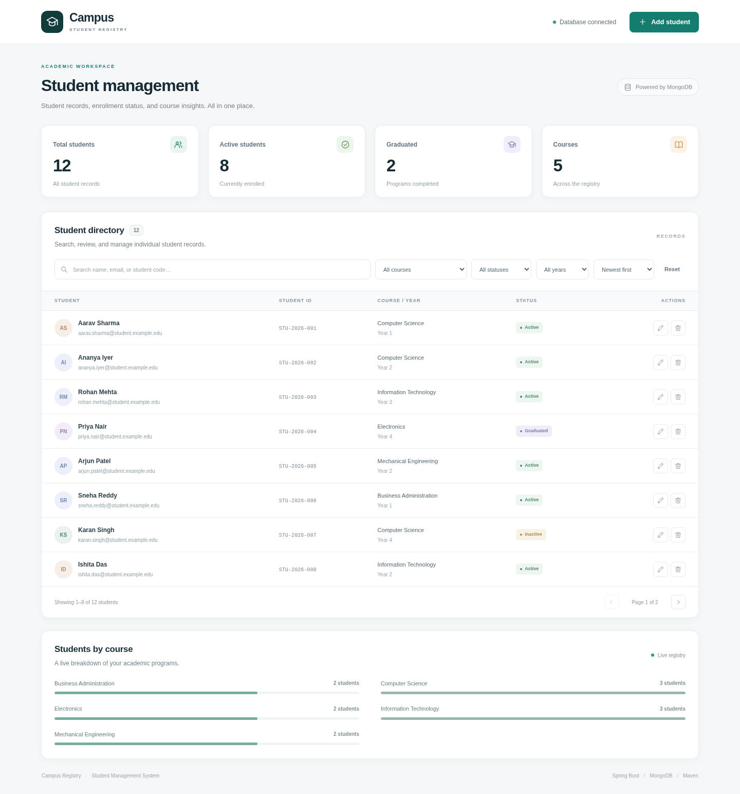
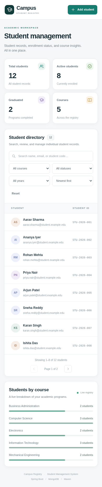

# Student Management System using Spring Boot and MongoDB

**Final Project Report**

- Student: ____________________
- Roll number: ____________________
- Institution: ____________________
- Guide: ____________________
- Date: October 2026

## Abstract

The Student Management System is a web application that demonstrates backend development with MongoDB, CRUD integration, query and index optimization, replication, backup strategies, deployment, and testing. The backend uses Java 17, Spring Boot, Maven, and Spring Data MongoDB. The frontend uses plain HTML, CSS, and JavaScript without a frontend build framework. MongoDB stores student documents, enforces uniqueness through indexes, and supports filtered queries and aggregation-based dashboard statistics. The project includes standalone and replica-set deployment configurations, backup and restore scripts, automated tests, and operational documentation.

## 1. Introduction

Educational institutions need a simple way to maintain student records and view enrollment information. A document database is suitable for this project because each student record is naturally represented as a single document. The application focuses on a clear REST API, correct validation, measurable query performance, and practical database operations rather than unnecessary framework complexity.

## 2. Objectives

1. Develop a backend application using MongoDB.
2. Integrate create, read, update, and delete operations.
3. Design queries and indexes for optimal performance.
4. Implement and demonstrate replication and backup strategies.
5. Deploy and test the application.
6. Provide a normal HTML/CSS/JavaScript frontend connected to the backend.

## 3. Requirements

### Functional requirements

- Add, view, edit, and delete student records.
- Validate required fields, email format, year level, and enrollment status.
- Prevent duplicate email addresses and student codes.
- Search students and filter by course, status, and year.
- Sort and paginate results.
- Display total, active, inactive, graduated, and course-wise counts.
- Provide health checks and operational scripts.

### Non-functional requirements

- Java 17 compatibility and Maven-based builds.
- Bounded pagination and indexed common queries.
- Consistent JSON errors without internal stack traces.
- Responsive frontend.
- Repeatable deployment and test procedures.
- Documented replication, backup, restore, and security limitations.

### Technology stack

| Layer | Technology |
|---|---|
| Backend | Java 17, Spring Boot 3.5.16, Maven |
| Database | MongoDB 8.0, Spring Data MongoDB |
| Frontend | HTML5, CSS3, vanilla JavaScript |
| Testing | JUnit 5, Mockito, MockMvc, local MongoDB integration tests, Playwright |
| Deployment | Executable JAR and native MongoDB service |
| Operations | mongosh, mongodump, mongorestore, shell scripts |

## 4. System design

### Architecture

```text
Browser (HTML/CSS/JavaScript)
        |
        | same-origin REST/JSON
        v
Spring Boot controllers
        |
        v
Service layer: validation, normalization, query building, aggregation
        |
        v
Spring Data MongoDB / MongoTemplate
        |
        v
MongoDB students collection
```

The frontend and backend are served from the same origin, avoiding CORS complexity. Controllers handle HTTP concerns, the service layer contains application logic, and MongoDB handles persistence, uniqueness, indexing, and aggregation.

### Database design

Collection: `students`.

| Field | Type | Notes |
|---|---|---|
| `_id` | ObjectId | Generated by MongoDB |
| `studentCode` | String | Uppercase, unique |
| `firstName`, `lastName` | String | Required, trimmed |
| `email` | String | Lowercase, unique |
| `course` | String | Exact filter value |
| `yearLevel` | Integer | 1–6 |
| `status` | String | ACTIVE / INACTIVE / GRADUATED |
| `createdAt`, `updatedAt` | Date | Server-owned UTC timestamps |

A single student is a single-document aggregate. CRUD writes are atomic at document level. Multi-document transactions are not required for the implemented operations.

## 5. Implementation

### CRUD API

- `POST /api/students` creates a student and returns `201 Created` with a Location header.
- `GET /api/students` returns a paginated result.
- `GET /api/students/{id}` returns one record.
- `PUT /api/students/{id}` atomically replaces editable fields and preserves identity and creation time.
- `DELETE /api/students/{id}` removes a record and returns `204 No Content`.
- `GET /api/dashboard/stats` returns aggregation results.

Bean Validation rejects invalid input. Unknown JSON properties are rejected. Duplicate-key exceptions are translated into `409 Conflict`. Missing records return `404`, and database connection failures return `503` without leaking internal details.

### Queries

The list endpoint combines optional text search, exact course match, status, and year filters. Sorts are allowlisted (`newest`, `name`, `year`) and include a stable `_id` tie-breaker. Page size is limited to 100 and offset to 10000 to avoid unbounded queries. Text search uses a MongoDB text index and whole-word matching.

### Frontend

The frontend provides a dashboard, searchable student table, filters, pagination, add/edit dialog, delete confirmation, inline validation errors, and live course statistics. It uses DOM APIs and `textContent` for user-supplied values rather than injecting HTML.

## 6. Query and index optimization

Indexes include unique email and student-code indexes, a compound course/status/year/created index, status/created, created, name, year/created, and one weighted text index. Equality fields precede sort fields in the compound index. The production profile disables automatic index creation so indexes can be applied as a controlled migration.

A reproducible 20,000-document benchmark was run on MongoDB 8.0.34:

| Query | Without secondary indexes | With indexes |
|---|---|---|
| Exact email lookup | `COLLSCAN`; 20,000 documents examined; ~8.875 ms average | `EXPRESS_IXSCAN`; 1 document examined; ~1.625 ms average |
| Course + status + year, newest 10 | `COLLSCAN + SORT`; 20,000 documents examined; ~10.425 ms average | `IXSCAN + FETCH + LIMIT`; 10 documents examined; ~1.425 ms average |

The indexed filtered query avoids a blocking sort because the index order matches the requested sort. These results are local warm-cache measurements and should not be treated as production capacity guarantees.

## 7. Replication strategy

The project documents how to start a three-node replica set with native MongoDB processes. All members are data-bearing; there is no arbiter. The application uses a replica-set URI with retryable writes, majority write concern, majority read concern, and primary read preference. Majority writes reduce the risk of losing acknowledged writes during elections, while primary reads keep the UI consistent after writes.

A local three-node replica set was verified directly:

1. A majority write was acknowledged.
2. The written marker was read from a secondary.
3. The primary was stopped and another node was elected.
4. The new primary accepted a majority write.
5. The stopped node rejoined healthy and reclaimed primary because of its higher priority.
6. The Spring Boot API passed CRUD smoke tests against the replica set.

The native three-process replica demonstration runs on one host and is intended for education. Production replication requires separate failure domains, authentication, TLS, monitoring, and capacity planning.

## 8. Backup and restore strategy

Replication is not a backup because accidental deletes replicate to secondaries. The project therefore includes logical backup and restore scripts with checksums and manifests.

The included selected-database script is a **quiesced** backup: application writes are paused before `mongodump`. This works for standalone and replica-set targets. For live replica-set backups, the operations guide documents full-instance `mongodump --oplog` and `mongorestore --oplogReplay`, or filesystem/cloud snapshots. MongoDB requires `--oplog` to be used with a full dump, not a selected-database dump.

Verification performed:

- Standalone backup of 12 student records restored to an isolated MongoDB instance on another port.
- Restored data verified: 12 records, 9 indexes, unique email index, and a known sample record.
- Selected-database backup/restore verified on an isolated test replica.
- Full-instance `--oplog` backup and `--oplogReplay` restore verified on the test replica.

Recommended policy: daily backups, off-host encrypted copies, defined retention, and monthly restore drills. Example educational objectives are RPO ≤ 24 hours and RTO ≤ 2 hours; tighter objectives require more frequent snapshot/oplog or managed backup protection.

## 9. Deployment

The application runs as an executable JAR or from the Maven wrapper, with MongoDB installed as a native service. The regular setup uses a standalone local server; an optional three-process local replica set demonstrates elections and majority writes. Configuration is environment-driven: MongoDB URI, port, index auto-creation, and demo seeding. The production profile disables automatic seeding and startup index creation by default.

The project intentionally has no Docker dependency or container deployment files. The executable JAR, standalone MongoDB, native three-node replication, and backup/restore were tested directly.

## 10. Testing and results

| Test area | Result |
|---|---|
| Unit/service tests | 13 passed |
| Controller/validation/error tests | 9 passed |
| Real-MongoDB integration tests | 16 passed |
| HTTP smoke test | Passed on standalone and replica-backed API |
| Browser workflow | Passed: desktop/mobile, CRUD, duplicate validation, search, filters, pagination |
| Index migration | Passed; idempotent rerun reported all indexes already exist |
| Performance benchmark | Passed; query plans and timings recorded |
| Standalone backup/restore | Passed; 12 records and 9 indexes restored |
| Replication/failover | Passed; election, secondary read, rejoin, API CRUD |
| Replica oplog backup/restore | Passed on isolated test replica |

Integration tests cover CRUD lifecycle, duplicate constraints, validation, unknown fields, missing IDs, filters, pagination, text search, operator-injection resistance, stable sorting, aggregation, index existence and usage, request bounds, and health.





## 11. Limitations and future work

- No authentication or role-based authorization is included; this must be added before real student data is used.
- The local MongoDB development service and replica demonstration are unauthenticated and do not enable TLS.
- Updates use last-writer-wins semantics; optimistic locking could be added for concurrent editing.
- Text search is whole-word, not fuzzy/substring search.
- Deep pagination is bounded rather than keyset-based.
- Backup scheduling, off-host upload, retention pruning, and alerting are operational responsibilities.
- Future work: staff/student roles, audit logs, course collection with references, attendance, reporting/export, optimistic locking, and managed Atlas backup.

## 12. Conclusion

The project satisfies the stated final-project requirements with a working Spring Boot/MongoDB backend, integrated CRUD, indexed queries, aggregation, replication and backup procedures, native deployment instructions, and automated tests. The measured query-plan improvements and verified restore/failover drills provide concrete evidence that the system addresses both functional and operational database concerns.

## References

1. Spring Boot Reference Documentation — https://docs.spring.io/spring-boot/
2. Spring Data MongoDB — https://docs.spring.io/spring-data/mongodb/reference/
3. MongoDB: Deploy a Self-Managed Replica Set — https://www.mongodb.com/docs/manual/tutorial/deploy-replica-set/
4. MongoDB: Back Up and Restore with MongoDB Tools — https://www.mongodb.com/docs/manual/tutorial/backup-and-restore-tools/
5. MongoDB: mongodump — https://www.mongodb.com/docs/database-tools/mongodump/
6. MongoDB: mongorestore — https://www.mongodb.com/docs/database-tools/mongorestore/

## Appendix: Short viva questions

**Why MongoDB?** Student records map naturally to documents, and the project uses document-level atomic writes, indexes, text search, aggregation, and replica sets.

**Why unique indexes instead of only checking in Java?** A pre-check can race with another request. The database index enforces uniqueness under concurrency.

**Why put equality fields before sort fields in an index?** It lets MongoDB narrow the index range and return results in index order, avoiding a blocking sort.

**Why is replication not a backup?** Mistakes and deletes replicate. Backups provide recoverable historical copies.

**Why does the selected-database script require a write pause?** `mongodump --oplog` requires a full-instance dump. A selected-database dump needs quiesced writes for a consistent application snapshot.

**Why primary reads?** They avoid stale reads from secondaries immediately after a write in the UI.
